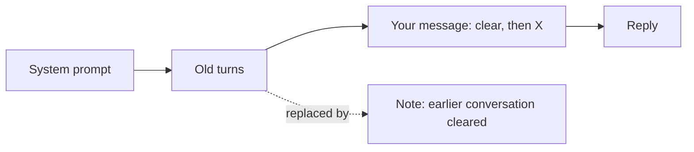

# dsh-clear-conversation

**Say "clear everything above" and DeepSeek Harness actually forgets it.**

[](https://github.com/deepseek-ai/deepseek-harness)
[](https://github.com/topics/dsh-plugin)
[](LICENSE)


Long sessions get slow and expensive: every request resends the whole history, and old topics leak into new answers.
This [DeepSeek Harness](https://github.com/deepseek-ai/deepseek-harness) (`dsh`) plugin lets you drop that history in plain words, mid-conversation, without starting a new session.

What a session looks like (illustrative):

```text
You:   My favourite colour is green. Now help me name a cat.
dsh:   How about "Basil"? It suits a green-loving owner.

You:   Clear everything above, then tell me a joke.
dsh:   [clear_conversation]  Context cleared.
       Why don't skeletons fight? They don't have the guts.

You:   What's my favourite colour?
dsh:   I don't know. You haven't told me in this conversation.
```

## Quick start

```sh
dsh plugin --profile web add github:William20100221/dsh-clear-conversation
dsh web
```

That's it: no build step and no configuration. New to dsh, or want to try it safely first? See [TESTING.md](TESTING.md).

## Features

- **Ask naturally.** "Clear everything above", "forget the previous chat", "start over", 清空上下文, in any language.
- **Keeps your request.** "Clear, then do X" still does X: only the turns before your message are dropped.
- **Saves tokens immediately.** The model stops receiving the old turns from its very next request, even within the same turn.
- **Nothing is deleted.** Old turns stay in the transcript and the session log; they just stop being sent.
- **Hard to trigger by accident.** Casual phrases like "forget it, let's move on" or "how do I clear the context?" are ignored.
- **`/clear` command.** Clear everything yourself while the agent is idle (Web and SDK).
- **Safe by construction.** The system prompt is never touched, and a clear that would split an unfinished tool call is refused.

## How it works

dsh builds every request from the session's *surface*, an ordered list of messages. Its own `/compact` command replaces a run of old turns with an AI-written summary. This plugin uses the same mechanism, but writes one short note instead of a summary, so it costs nothing to run.



## FAQ

**Does it delete my messages?** No. The transcript and session log keep everything. Only the model's view changes.

**Can I undo a clear?** Not yet. The old turns stay readable, but cannot be put back into the model's context.

**Which dsh surfaces does it work in?** The tool works everywhere the model runs. `/clear` appears where dsh shows commands: Web and SDK, not ACP or headless.

**How do I remove it?** `dsh plugin --profile web remove dsh-clear-conversation`, then restart dsh.

**Status?** Preview, for dsh 0.2.1-rc.5 and later 0.2.x releases. The clearing logic is covered by tests; a live run inside dsh is still being confirmed. Please [open an issue](https://github.com/William20100221/dsh-clear-conversation/issues) if something breaks.

## Other harnesses

This repo also keeps the earlier Cherry Studio work. Each part works on its own.

### Cherry Studio chats: MCP server

[`mcp-server`](mcp-server) is a tiny tool you add in Cherry Studio's MCP settings. No fork needed, and it really saves tokens.
It works by writing the Ctrl+K divider into Cherry Studio's database, with a backup first. If a Cherry Studio update changes the database, it stops and asks you to update.

- Needs Node.js 22.13 or newer. `node server.mjs --check` verifies your setup and tells you when a newer version exists.
- Chats only. Agents keep their memory in Claude's own transcript, which nothing outside the app can reset; use the fork for agents.

See the [MCP server README](mcp-server/README.md) for install steps.

### Any skill-loading app: the skill

[`skill/clear-conversation`](skill/clear-conversation) is an Agent Skill. It works in stock Cherry Studio agents, Claude Code, and other apps that load skills.

- Install it from the latest release ZIP, or from GitHub with the link to its `SKILL.md`.
- Without special app support, it does a **soft reset**: the model ignores the earlier conversation and tells you the app's own way to clear for real.

See the [skill README](skill/clear-conversation/README.md) for install steps and phrases.

### Cherry Studio fork

[William20100221/cherry-studio, branch `feature/clear-context-tool`](https://github.com/William20100221/cherry-studio/tree/feature/clear-context-tool) adds a built-in `clear_conversation` tool. With it, a clear is real: older messages stay on screen but are no longer sent to the model, which saves tokens.

| | Chat topic | Agent session |
|---|---|---|
| Needs the skill | No, the tool's description is enough | Yes, for the full rules |
| Where the divider goes | Directly above the message that asked | After the current turn |
| When the fresh start begins | The next turn | The next turn, once the session is idle |
| Undo | Click the divider, or the Undo toast | The Undo toast (10 s) |
| Ctrl+K / eraser | Divider now, or a queued clear while streaming | Same |
| Ctrl+L | Stops the reply, then divider or delete (setting), queue continues | Same |
| Delete mode | Always asks first, also when the model requests it | Same |

Settings → Context Management has two switches: the default clear action (divider or delete) and whether the assistant may clear at all.

In an Agent session, follow-ups already queued behind the clearing turn still run with the old context.

## Development

```sh
npm test
```

The tests exercise the clearing logic against a stand-in session; they do not start dsh.

## License

MIT for this repo. The Cherry Studio fork stays under Cherry Studio's AGPL-3.0 license.
