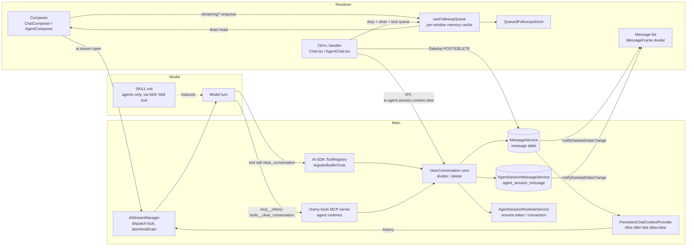
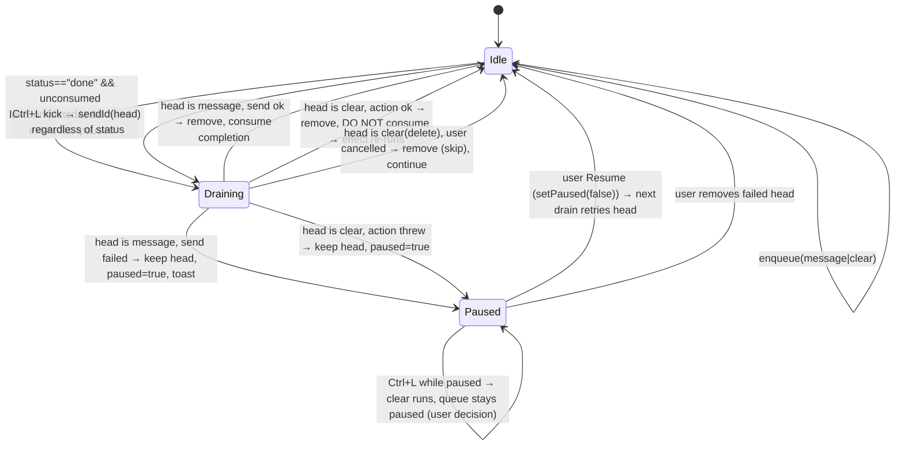

# Clear Context for Cherry Studio — Design and Development Plan

Status: **draft for review, no code written**
Research base: `CherryHQ/cherry-studio` `main` @ `4637aa0b56` (v2.1.8, 2026-10-29), plus the heads of the unmerged PRs #18653 and #19386 fetched locally.
All file paths below are relative to the Cherry Studio repo root. Every claim is either verified in that code or marked **[assumption]**.

---

## 0. What the code says versus what the brief assumed

Read this first. Several things in the brief do not match `main`, and they shape the whole design.

| Brief assumed | What `main` actually has | Where |
|---|---|---|
| The follow-up queue is in PR #18653 | The **core queue is already in `main`** (enqueue while streaming, head-only auto-drain, reorder, edit, remove, pause/resume, pause-on-failure). PR #18653 only adds queue limit, Clear Queue, Skip/Retry/Abort banner, 3-item expand/collapse. It is **open, unmerged and stale**: its base predates two later rewrites of the same hook. | `src/renderer/components/composer/useFollowupQueue.ts`, `QueuedFollowupsDock.tsx`; PR state checked with `gh` |
| PR #19386 makes Ctrl+L work in Agent sessions | **Open, unmerged, 6 weeks stale.** On `main`, Ctrl+L in an Agent session does nothing (`AgentChat.tsx` has no `useCommandHandler`). The PR also changes `abortAndDrain`'s third parameter to `afterDrain`, but `main` has since added a *different* third parameter `beforeAbort`, so the PR conflicts. | `src/main/ai/streamManager/AiStreamManager.ts:1244`, `src/renderer/pages/agents/AgentChat.tsx` |
| A "context divider" may need to be invented | **It already exists for Chat.** A hidden `data-clear` message part marks a context boundary; Ctrl+K (`chat.context.toggle_new`), the Eraser toolbar button and the quick panel toggle it. History sent to the model is cut after the last such part. **Agent sessions have no divider at all.** | `src/shared/data/types/uiParts.ts:364-379`, `src/renderer/pages/home/hooks/useChatWriteActions.ts:137-180`, `src/main/ai/streamManager/context/PersistentChatContextProvider.ts:915-917` |
| A skill (SKILL.md) works in Chat topics and Agent sessions | **Skills attach to Agents only.** They reach the model through the Claude Agent SDK's native `Skill` tool. Chat assistants never load a SKILL.md and Cherry writes no skill list into any system prompt. In Chat, the only thing that can make the model call a tool is the **tool's own description**. | `src/main/ai/skills/SkillService.ts:60-68`, `src/main/ai/agents/prompt.ts:118-119`, `src/main/ai/runtime/claudeCode/skillDependencies.ts:24` |
| An external MCP server might reach the messages | **It cannot.** The local API gateway (off by default, port 23333) has generation, models, knowledge and MCP-proxy routes, but **no route that lists or deletes topic or session messages**. The remote JSON-RPC surface is read/send only. Message writes exist only inside the main process. | `src/main/features/apiGateway/app.ts:40-60`, `routes/*.ts`, `packages/remote-protocol/src/agent/*` |
| Deleting an Agent session's rows clears its context | **No.** Agent context lives in the Claude Agent SDK's own JSONL transcript, resumed through `runtimeResumeToken` / `nativeSessionId` stored on the message rows. Cherry's rows are the UI record. A clear must also stop the runtime from resuming the old transcript. | `src/main/ai/agentSession/AgentSessionRuntimeService.ts:1840-1853, 1887-1899`, `src/main/data/services/AgentSessionMessageService.ts:376-390, 958-968` |
| Ctrl+L in Chat stops the stream | **It does not.** The handler confirms, then issues `DELETE /topics/:topicId/messages`. No abort. And after any abort the queue **does not auto-drain** (it drains only on `status === 'done'`), so queued messages would stall. | `src/renderer/pages/home/Chat.tsx:167-184`, `useFollowupQueue.ts:238-245` |
| `/clear` is a command | `/clear` in the slash menu only inserts text into the draft. | `src/renderer/components/composer/tools/definitions/slashCommandsTool.tsx:11` |
| Queue survives restart | Queue lives in the **per-window memory cache** with a 24 h TTL. Lost on reload and restart, not shared between windows. Issue #13417 asked for persistence; PR #18653 explicitly dropped it. | `useFollowupQueue.ts:16-20`, `src/renderer/data/CacheService.ts:9` |

Consequence: the project is smaller in some places (divider and queue exist) and harder in others (Agent context reset, Chat has no skills). The recommended approach below is built around that.

---

## 1. Summary and goals

### Goal

Let the user reset the conversation context in a Cherry Studio Chat topic or Agent session in three ways:

1. **Natural language** inside a normal message ("clear everything above, then …"). The model calls a Cherry-owned tool, the context is reset, and the model answers the rest of the message.
2. **Queued** while a reply is still generating. The clear request waits in the follow-up queue and executes in order, before the next queued message is sent.
3. **Ctrl+L while streaming.** The current turn is stopped safely, the context is reset, and queued messages continue instead of stalling.

Default mode inserts a **context divider** (old messages stay visible, not sent). An optional **delete** mode removes messages and **always asks for confirmation**.

### Non-goals (out of scope)

- Persisting the follow-up queue across restarts (upstream dropped it; see §8.4).
- Changing compaction, token-budget or `maxMessages` behaviour.
- Per-message selective deletion ("delete the last three").
- Clearing other topics or sessions than the active one.
- Making a SKILL.md work in Chat topics (not supported by the app; the tool description carries the Chat behaviour instead).
- Undo for delete mode (hard delete today, no soft-delete code path; `deletedAt` column exists but nothing writes it: `src/main/data/db/schemas/message.ts:74-75`, `MessageService.ts:1743-1833`).

---

## 2. Approach decision

### Options

| | (a) Skill + external MCP server, no fork | (b) Skill + built-in tool in a fork | (c) App-only changes, no skill |
|---|---|---|---|
| Can the model be triggered by natural language? | Agents: yes (skill). Chat: only via the MCP tool's description. | Agents: skill + tool. Chat: tool description. | No model involvement; needs client-side phrase matching. |
| Can it actually clear messages? | **No.** No gateway/remote endpoint writes messages (§0). The MCP server would run in a separate process with no way into `MessageService`. | **Yes.** A built-in tool's `execute` runs in the main process and can call `messageService` / `agentSessionMessageService` directly, like `cherryAutonomyTools.ts:386-391` already does. | Yes, same reach as (b). |
| Works while streaming / queued? | No. | Yes, with the queue and Ctrl+L changes. | Yes. |
| Handles ambiguity ("I wish I could clear my head") | Model judgement. | Model judgement. | Regex cannot; false positives are destructive. |
| Needs a fork? | No. | Yes. | Yes. |
| Publishable as a skill repo? | Yes, but the skill does nothing useful. | Yes (agents) — plus a tool the fork ships. | No. |

### Why (a) is dead on arrival

Verified: there is no HTTP route for messages (`src/main/features/apiGateway/app.ts:40-60`; `routes/messages.ts` is the Anthropic-compatible *generation* endpoint, not storage). The in-process `DataApi` is never mounted on the gateway (`app.ts:8,142` only reuse its error shapes). An external process therefore has no door. Even a hypothetical "clear" endpoint would still not reset Agent context, which needs runtime cooperation (§4.4).

### Why (c) alone is not enough

Pure client-side detection would have to decide from text whether "forget what I said earlier about the budget" is a clear request. The model is far better at that, and the brief explicitly wants the model to refuse ambiguous or casual mentions. (c) is still useful as a **complement**: the existing Ctrl+K / Eraser / `/clear` entry points become the way to put an explicit *action* item into the queue (§5).

### Recommendation: (b), with one honest caveat

Build a built-in tool `clear_conversation` in a fork, registered twice from one core function — once in the AI-SDK tool registry for Chat, once in the in-process `cherry-tools` MCP server for Agents. This is exactly how `web_search` is wired today (`src/main/ai/tools/adapters/aiSdk/builtin/WebSearchTool.ts` + `src/main/ai/mcp/servers/cherryBuiltinTools.ts:89-121`).

The SKILL.md is **Agent-only** by the app's design. It adds the trigger phrases, the "don't clear when…" rules and the confirmation etiquette for agents. For Chat, the same rules must live in the **tool description** (and, optionally, in a short line of the assistant prompt the user adds themselves). The skill repo is still worth publishing: it is where agent users install the behaviour, and it documents the tool.

---

## 3. Architecture



Reading the diagram:

- **Composer → queue.** Unchanged entry: `handleSendDraft` enqueues while a turn is live (`ChatComposer.tsx:1829-1856`, `AgentComposer.tsx:1659-1692`). New: Ctrl+K / Eraser / `/clear` while live enqueue a **clear action item** instead of being blocked.
- **Tool/skill → core.** One main-process function `clearConversation(target, mode)` is the only thing that mutates. Both tool registrations and the Ctrl+L IPC route call it.
- **Message store → history.** For Chat, nothing new is needed on the read side: `resolveCompactedHistory` already drops everything up to the last `data-clear` part. For Agents, the read side is the **resume-token lookup**, which must be scoped to after the boundary (§4.4).

---

## 4. Detailed flows

Notation: `U_n` = the user message being answered, `A_n` = its assistant placeholder row, `A_{n-1}` = previous assistant message (parent of `U_n`).

### 4.1 Natural-language clear in a Chat topic (divider mode)

```
User sends: "clear everything above, then explain the Big-O of merge sort"
  renderer: handleSendDraft → ai.stream.open (full history, as today)
  main:     prepareDispatch persists U_n (parent A_{n-1}) and A_n (pending)
            resolveCompactedHistory → model sees old history + U_n
  model:    recognises an explicit clear request (tool description / skill)
            calls clear_conversation({ mode: "divider", scope: "before_current" })
  main tool execute (AI-SDK path):
    ctx = getToolCallContext(options).request         // topicId, userMessageId (new field, §6)
    result = clearConversation({ kind: "topic", topicId, beforeMessageId: userMessageId }, "divider")
      MessageService.insertContextBoundaryBefore(userMessageId)   // one withWriteTx:
        D = create(topicId, { parentId: U_n.parentId, role: "user", status: "success",
                              data: { parts: [createClearContextPart()] } })
        update(U_n.id, { parentId: D.id })             // reparent — supported, MessageService.ts:1323-1360
      notifyDataApiDataChange(/topics/:topicId/messages, /topics/:topicId/tree)
    return { ok: true, mode: "divider", clearedCount: n, undoable: true }
  model:    continues the same turn, answers the merge-sort question
  renderer: divider appears above U_n; next turn's history starts at U_n
```

Honest limitation: in this turn the model's context window still contains the old history (it was sent before the tool ran). The tool result tells the model to answer "as if from a clean start"; the next turn is truly clean. If you want a *real* clean start inside the same turn, see Phase 7 (restart-turn, optional) and Open question Q2.

Why insert *before* `U_n` and not after `A_n`: the slice is `messagePath.slice(lastClearIndex + 1)`, so a divider after `A_n` would also drop the question just answered and its answer. Reparenting is allowed by `MessageService.update` (same-topic parent, cycle checks) — verified at `MessageService.ts:1346-1359`.

### 4.2 Natural-language clear in an Agent session (divider mode)

```
model (Claude Code runtime) calls mcp__cherry-tools__clear_conversation({ mode: "divider" })
main tool handler (cherry-tools server, has ctx.sessionId):
  clearConversation({ kind: "session", sessionId }, "divider")
    AgentSessionMessageService.insertContextBoundary(sessionId)
      insert row { role: "user", status: "success", data: { parts: [data-clear] } }   // role allowed: user|assistant|system
    AgentSessionRuntimeService.scheduleContextReset(sessionId)
      marks entry.contextResetPending = true
  return { ok: true, mode: "divider", note: "runtime restarts fresh on the next turn" }
model: finishes the current turn normally (its own context is unchanged for this turn)
main, on terminal of this turn (existing onExecutionDone path):
  if entry.contextResetPending:
    closeSession(sessionId)                 // drop warm connection
    entry.lastResumeToken = undefined       // so hydrateResumeToken re-reads from DB
next turn:
  getLastRuntimeResumeToken / getNativeSessionId now only look at rows AFTER the boundary → null
  driver.connect({ resumeToken: undefined, nativeSessionId: undefined }) → new SDK transcript
```

Two code changes make this work: scope the two lookups in `AgentSessionMessageService` (`:376-390`, `:958-968`) to `createdAt > lastBoundary.createdAt`, and reset the in-memory token. **[assumption]** `closeSession` does not re-hydrate the token from the closing connection in a way that defeats the reset — `AgentSessionRuntimeService.ts:1717-1718` sets `entry.lastResumeToken = closing.resumeToken` when empty, so the reset must happen *after* that path settles. Verify in the spike (Phase 0).

Why not call `abortAndDrain` from inside the tool: the tool call is awaited inside the very loop `abortAndDrain` waits for → deadlock (documented invariant, `docs/references/ai/stream-manager.md:275-283`). Hence "mark now, reset at terminal".

### 4.3 Clear request queued while a reply is streaming

There are two shapes of queued clear, and both are supported.

**(i) Natural-language text queued as a normal message.** The user types "forget the previous chat, now …" while streaming. The composer cannot know the intent, so it is a normal `message` item. When it drains, the model runs §4.1/§4.2. The context is reset *inside* that turn, so by the time the next queued message dispatches, it starts after the divider. No new mechanism required.

**(ii) Explicit `clear` action item.** Produced when the user presses Ctrl+K, clicks the Eraser, or sends `/clear` while a turn is live (today Ctrl+K is blocked while streaming: `useChatWriteActions.ts:141` `startNewContextBlocked` **[assumption: that flag is the streaming guard; verify]**).

```
enqueue({ kind: "clear", mode: preference or "divider" })
...
turn completes → status "done", new lastCompletedAt
drain effect: head is a clear item
  sendItem(head):
    onDrainAction(head):
      divider: startNewContext()  (Chat)  |  ipc ai.agent.session.context.clear {mode:"divider"} (Agent)
      delete : popup.confirm(...) → if confirmed clear; if cancelled → treat as skipped
    removeId(head)
    do NOT mark this completion as consumed      ← lets the next head drain on the same completion
  effect re-runs (state changed, consumed still false) → next head (a message) sends normally
```

Rationale for "not consumed": in `useFollowupQueue.ts:218-232` a successful send marks `consumed` for `lastCompletedAt`, which is what enforces "one send per completion". A clear item produces no model turn, so it must not spend the completion, otherwise the following message would wait for a completion that never comes.

### 4.4 Ctrl+L while streaming, with messages queued

```
Chat.tsx / AgentChat.tsx command handler 'topic.clear_messages'
  mode = preference chat.clear_context.default_mode  ('divider' default)
  if mode == 'delete': confirmed = popup.confirm(...)  → return if not confirmed
  if a turn is live:
    await stop()                           // useChatWithHistory.stop → ai.stream.abort → abortAndDrain
                                           // resolves after partial A_n is persisted as status 'paused'
  Chat:
    divider: startNewContext()             // divider becomes child of A_n (paused) — existing toggle
    delete : clearTopicMessages(topicId)   // existing DELETE route
  Agent:
    ipc 'ai.agent.session.context.clear' { sessionId, mode }
      main: abortAndDrain(agent topic, 'user-requested', /*beforeAbort*/ undefined)
            then divider: insertContextBoundary + reset token   |   delete: delete rows (port of PR #19386's post-drain delete, rebased on main's beforeAbort signature)
  queue:
    if queue has items and not paused: followupQueue.sendId(head.id)   // explicit kick, status is 'aborted' so no auto-drain
```

Why the explicit kick is mandatory: the drain effect requires `status === 'done'` and an unconsumed `lastCompletedAt` (`useFollowupQueue.ts:239`). After Ctrl+L the status is `aborted` and `lastCompletedAt` **[assumption]** is not advanced, so without the kick the queue would silently stall — which is exactly the "thrown away" experience the brief wants to avoid.

Design choice to confirm (Q3): in **divider** mode Ctrl+L shows **no** confirmation dialog, since it is non-destructive and reversible; in **delete** mode it always confirms (brief requirement). Today Ctrl+L always confirms because it always deletes.

### 4.5 Divider mode vs delete mode

| | Divider | Delete |
|---|---|---|
| Chat storage | New `user` message with `[data-clear]` part (existing type) | `MessageService.clearTopicMessages` (existing) |
| Chat history effect | `resolveCompactedHistory` slices after it (existing) | Nothing left to send |
| Agent storage | New `agent_session_message` row with `[data-clear]` part | Delete all rows (PR #19386 logic) |
| Agent runtime effect | Resume lookups scoped after boundary → fresh SDK session | Rows gone → `getLastRuntimeResumeToken` null → fresh SDK session (same as PR #19386 notes) |
| Confirmation | None | Always (`popup.confirm`) |
| Undo | Yes: toggle/delete the divider (Chat: existing Ctrl+K toggle; Agent: delete boundary row) | No |
| Safe mid-stream | Yes (inserting a node does not touch the live `A_n`) | No — must `abortAndDrain` first, otherwise the terminal persist re-touches a deleted row |
| Triggerable by the model | Yes | Only as a *request*: tool returns `confirmation_pending`, renderer prompts (§4.6) |

### 4.6 Model requests delete mode

```
model calls clear_conversation({ mode: "delete" })
main tool: does NOT delete. Emits IpcApi event 'ai.conversation.clear_requested' { target, requestedBy: 'model' }
           returns { ok: false, status: "confirmation_pending", message: "User must confirm in the app." }
renderer (useIpcOn): shows the same popup.confirm as Ctrl+L delete
  confirmed → runs §4.4 (stop if still live, delete, kick queue)
  cancelled → toast "Not cleared"
model: says "I've asked you to confirm the deletion in Cherry Studio."
```

This reuses the Ctrl+L path, so delete never happens mid-turn and never without the user.

---

## 5. Queue state machine

Item kinds: `message` (today's item) and `clear` (new).



Rules:

- Order is strict FIFO; a `clear` behind a failed `message` waits like any other item.
- A `clear` item is drained **without** spending the completion, so the message after it drains on the same completion edge.
- Dock steer button (ArrowUp) on a `clear` item executes it now (same as `sendId`); steer on a `clear(delete)` prompts.
- `takeForEdit` is disabled for `clear` items (nothing to edit); the Pencil button is hidden.
- If PR #18653's Skip/Retry/Abort ever lands, `clear` items participate unchanged: Skip removes, Retry re-runs the action, Abort clears the queue.

---

## 6. Data model and API

### 6.1 Queue item type

`src/renderer/components/composer/useFollowupQueue.ts` (today `useFollowupQueue.ts:8-14`):

```ts
export type FollowupQueueItem =
  | { id: string; kind: 'message'; draft: ComposerSerializedDraft; payload: ComposerQueuedMessagePayload }
  | { id: string; kind: 'clear'; mode: 'divider' | 'delete' }

// Backward compatibility with cached items that predate `kind`: treat missing kind as 'message'.
```

Controller additions: `enqueueAction(action: { kind: 'clear'; mode })`, and a new param `onDrainAction(item) => Promise<boolean>` next to `onDrain`. `sendItem` branches on `kind`.

### 6.2 Tool

Name: `clear_conversation` (snake_case like `web_search`, `kb_manage`, `session_rename`). Agents see it as `mcp__cherry-tools__clear_conversation`.

Input schema (zod, in `src/shared/ai/builtinTools.ts` next to the other tool constants):

```ts
export const CLEAR_CONVERSATION_TOOL_NAME = 'clear_conversation'
export const clearConversationInputSchema = z.object({
  mode: z.enum(['divider', 'delete']).optional()
    .describe('divider (default): keep messages visible but stop sending them. delete: remove them; always needs user confirmation.'),
  scope: z.enum(['before_current']).default('before_current')
    .describe('Only before_current is supported: everything above the message that asked for the clear.'),
  reason: z.string().max(200).optional()
    .describe('One short sentence quoting the user request that justified the clear. Shown in the UI.')
})
```

`mode` defaults to the preference `chat.clear_context.default_mode`.

Return value (JSON text content for MCP, object for AI-SDK `outputSchema`):

```ts
{
  ok: boolean,
  mode: 'divider' | 'delete',
  status: 'cleared' | 'confirmation_pending' | 'nothing_to_clear' | 'rejected',
  clearedCount?: number,          // messages now excluded (divider) or deleted
  undoable?: boolean,             // true for divider
  instruction: string             // e.g. "Context reset. Answer the remaining request without relying on earlier messages. Tell the user briefly that the context was cleared."
}
```

Tool description (doubles as the Chat "skill"): see §7.3 — it is kept short and references the same rules as the SKILL.md.

Approval: AI-SDK entry `needsApproval: false`, `defer: 'never'` (a deferred tool would not be visible without `tool_search`). Agent policy registry: `tool(CHERRY_MCP_SERVER.CHERRY_TOOLS, CLEAR_CONVERSATION_TOOL_NAME, 'auto')` in `src/main/ai/toolApproval/builtinToolPolicyRegistry.ts:85-130` — omission is fail-closed, so this entry is mandatory. Delete mode is protected by the renderer confirmation, not by tool approval.

Context needed by the Chat tool: `RequestContext` (`src/main/ai/tools/adapters/aiSdk/context.ts:16-80`) has `topicId` but no user message id. Add `userMessageId?: string` filled in `buildAgentParams.ts:291-309` from the request (`src/shared/ai/transport/stream.ts:151,165` carry `userMessageId` on the request types **[assumption: it is populated on the normal send path; verify in spike]**).

### 6.3 IPC and events

- New IpcApi route `ai.agent.session.context.clear` — input `{ sessionId, mode }`, output `{ deletedIds: string[]; boundaryMessageId?: string }` (schema in `src/shared/ipc/schemas/ai.ts`, handler in `src/main/ipc/handlers/ai.ts`). Delete branch ports PR #19386's `clearSessionMessages` + `persistExistingAssistantMessage` guard, rebased on `main`'s `abortAndDrain(topicId, reason, beforeAbort?)`.
- New push event `ai.conversation.clear_requested` in `AiEventSchemas` (`src/shared/ipc/schemas/ai.ts:519+`), sent with `IpcApiService.broadcastToType(WindowType.Main, …)` like `mcp.tool.call_progress`.

### 6.4 Settings

Two preference keys via `scripts/data-classify/data/target-key-definitions.json` + `npm run generate` (schemas are generated; never hand-edit `preferenceSchemas.ts`):

| Key | Type | Default | Meaning |
|---|---|---|---|
| `chat.clear_context.default_mode` | `'divider' \| 'delete'` (new `PreferenceTypes` union) | `'divider'` | Mode used by Ctrl+L, queued clear items and the tool when `mode` is omitted |
| `chat.clear_context.model_tool_enabled` | boolean | `true` | Exposes `clear_conversation` to models (Chat registry `applies` + agent server registration) |

No DB migration: the preference seeder materialises defaults (`docs/references/data/preference-schema-guide.md:54-56`).

### 6.5 Storage changes

| Store | Change | Migration? |
|---|---|---|
| `message` (Chat) | None. Divider = existing `data-clear` part; reparent = existing `parentId` update. New service method `insertContextBoundaryBefore(messageId)` wraps both in one `withWriteTx`. | No |
| `agent_session_message` | None in schema. New boundary row (role `user`, parts `[data-clear]`). Two read queries scoped to after the last boundary. | No |
| Preferences | Two keys (above) | No |
| Queue cache | `kind` field; missing `kind` read as `message` | No (memory tier) |

---

## 7. Skill design

### 7.1 Facts the skill depends on

- Format: YAML frontmatter parsed by gray-matter; fields read are `name`, `description`, `allowed-tools`, `version`, `tags`, `author` (`src/main/utils/markdownParser.ts:315-434`). Descriptor file `SKILL.md`.
- Install: Settings → Skills → Import (ZIP or folder) → `skill.install_from_zip` / `skill.install_from_directory` (`src/main/ipc/handlers/skill.ts:77-126`). ZIP must contain exactly one folder with a `SKILL.md`. Also installable from a GitHub URL of the SKILL.md (`github:` handle, `src/main/ai/skills/skillRemoteSource.ts:104-116`).
- Attach: per Agent (toggle in agent settings); the Claude Agent SDK loads it via the `Skill` tool from the mirrored `CLAUDE_CONFIG_DIR/skills`.
- The skill cannot reach Chat topics (§0).

### 7.2 Draft `SKILL.md`

```markdown
---
name: clear-conversation
description: Reset the current Cherry Studio conversation context when the user clearly and explicitly asks to clear, reset, forget or start over the chat above. Calls the built-in clear_conversation tool. Never use for casual mentions of "clear" or "forget", questions about the feature, or ambiguous requests.
version: 0.1.0
allowed-tools: mcp__cherry-tools__clear_conversation
tags: [cherry-studio, context, conversation]
author: William20100221
---

# Clear conversation

You can reset the conversation context with the `clear_conversation` tool.
It is a Cherry Studio built-in tool; if it is not available, say so and stop.

## When to call it

Call `clear_conversation` only when the user's **current message** contains an
explicit instruction to reset the conversation, such as:

- "clear everything above", "clear the context", "clear the chat"
- "forget the previous chat", "forget everything we discussed", "forget all of the above"
- "start over", "start fresh", "new context", "reset the conversation"
- "/clear" or "clear context" on its own line
- the same in other languages (e.g. 清空上下文, 忘记之前的对话, 重新开始; Kontext löschen; oublie la conversation)

Typical shape: the clear instruction comes first, followed by a new request.
Call the tool **first**, then answer the rest of the message.

## When you must NOT call it

- The word appears casually or about something else: "clear my schedule",
  "can you clear up what you meant", "forget it, let's move on", "I forgot to mention".
- The user asks *about* the feature: "can you clear the context?", "how do I reset?".
  Answer the question; do not clear.
- The request is ambiguous: "let's talk about something else", "moving on".
  Do not clear. If a reset might help, ask one short question first.
- The instruction is quoted, hypothetical, or inside pasted text, code or a file.
- You were not clearly asked. Never clear on your own initiative, for example
  to save tokens or because the topic changed.

## Mode

- Default is `divider`: earlier messages stay visible to the user but are no
  longer sent to you. This is reversible.
- Use `mode: "delete"` only if the user explicitly says to **delete** or
  **permanently remove** the messages. The tool will not delete by itself; it
  asks the user to confirm inside the app. Tell the user that a confirmation
  dialog is waiting.

## Ask before clearing when

- The user asks to delete (not just clear) and has not said "yes, delete" in this message.
- The request could refer to something other than this conversation
  (e.g. "clear the list").
- The same message also asks you to rely on earlier content
  ("clear the context and summarise what we said") — point out the conflict.

## After the tool returns

- `status: cleared` → answer the remaining request. Do not use information from
  before the clear, even though you may still see it in this turn. Start your
  reply with one short line such as "Context cleared." Then answer. Do not
  summarise or mention what was cleared.
- `status: confirmation_pending` → tell the user to confirm the deletion in the app, then continue with anything else they asked.
- `status: nothing_to_clear` → say the conversation was already empty and continue.
- `status: rejected` or an error → say the clear failed and continue without clearing.

Keep the acknowledgement to one line. Do not apologise or explain the mechanism.
```

### 7.3 Tool description (Chat equivalent)

The AI-SDK entry's `description` is a compressed version of the same rules, since Chat has no skill:

> Reset the conversation context. Call ONLY when the user's current message explicitly asks to clear/reset/forget the chat above or start over (any language). Never for casual uses of "clear"/"forget", questions about the feature, quoted text, or ambiguous requests like "let's move on". Call it before answering the rest of the message. Default mode `divider` keeps messages visible but stops sending them; `delete` only when the user says delete, and it requires in-app confirmation. After it returns, answer without relying on earlier messages and say "Context cleared." in one line.

---

## 8. Edge cases and risks

| # | Case | Handling |
|---|---|---|
| 8.1 | **Model clears by mistake** | Default mode is a divider: visible, one-click undo (click the divider / Ctrl+K toggles it, existing behaviour `MessageFrame.tsx:192-206`). The tool result carries `reason`, shown in the divider tooltip and in an "Undo" toast. Delete mode can never happen without the dialog. Setting `model_tool_enabled=false` removes the tool entirely. |
| 8.2 | **Clear in the middle of a reply (tool call mid-turn)** | Divider: inserting a node is safe; the live `A_n` row is untouched and finalises normally. Delete: never done inside the turn; routed through `clear_requested` → confirm → `abortAndDrain` first (§4.6). Agent: runtime reset deferred to the turn's terminal (§4.2). |
| 8.3 | **Clear item is the last in the queue** | It runs, removes itself, nothing follows. Completion is left unconsumed, which is harmless (the effect finds no head). |
| 8.4 | **App restarts** | Queue is memory-tier: all queued items, including a clear, are lost (upstream behaviour, `useFollowupQueue.ts:16-20`). Persisted state (divider rows, deleted rows, preferences) survives. An Agent `contextResetPending` flag would be lost with the process, so the **boundary row is the source of truth**: `hydrateResumeToken` reads the scoped lookup on next launch and still starts fresh. |
| 8.5 | **Multiple windows** | Storage changes broadcast through `notifyDataApiDataChange` to every window (`src/main/data/dataApiDataChange.ts:76-88`), so dividers/deletions appear everywhere. Queues are per window: Ctrl+L in window A kicks only A's queue; B's queue drains on the next completion as today. The `clear_requested` dialog is sent to Main-type windows only; if two main windows show the same topic, both get the prompt — first confirm wins, the second finds `nothing_to_clear`. |
| 8.6 | **Tool call inside an Agent session** | Handled by the MCP registration with `ctx.sessionId`; no `abortAndDrain` from inside the tool (deadlock); reset at terminal; resume lookups scoped after boundary. Pi runtime uses the same `buildAgentMcpServers`, so the tool is available there too (`src/main/ai/runtime/pi/PiRuntimeConnection.ts:358`) **[assumption: Pi's resume token semantics match; verify]**. |
| 8.7 | **Undo for divider mode** | Chat: existing toggle removes the divider node (`deleteMessageTrigger cascade:false`). Because the NL path *reparents* `U_n` under the divider, undo must reparent `U_n` back to `A_{n-1}`. Verified: `MessageService.delete(id, cascade=false)` "reparents children onto the deleted node's parent" (`docs/references/chat/message-tree.md:104`, `MessageService.ts:1722-1735`), so the existing toggle is a correct undo. Agent: deleting the boundary row restores the old token lookup → the next turn resumes the old SDK transcript. Undo offered as a toast action for 10 s after an NL clear, plus the permanent divider toggle. |
| 8.8 | **Ctrl+L with a pending tool approval** | `abortAndDrain` handles `awaiting-approval` streams like any live stream; the approval card disappears with the aborted turn. Queue kick applies. |
| 8.9 | **Queue paused after a failure, then Ctrl+L** | Clear runs immediately (it is a user action, not a queue item). The queue stays paused; the failed head remains for the user to Resume/remove. No automatic resume, to keep "a failure never auto-re-drains". |
| 8.10 | **Divider on an already-empty topic / right after another divider** | `insertContextBoundaryBefore` returns `nothing_to_clear` when the path above `U_n` is empty or already ends in a divider. Tool reports it; no duplicate rows. |
| 8.11 | **Agent terminal persistence after delete** | PR #19386's `persistExistingAssistantMessage` returning `false` prevents re-inserting cleared placeholders. Port it. Chat delete after `abortAndDrain` has no such race because the drain finished persisting before the delete ran. |
| 8.12 | **Stale PRs** | Do not cherry-pick #18653 or #19386 wholesale. Take #19386's service-level pieces (`clearSessionMessages`, delivery settlement, persist guard) and re-apply by hand on current `main`. |

---

## 9. UI / UX

### 9.1 Queued clear in the dock

`QueuedFollowupsDock.tsx` already renders rows with preview text, token chips, steer/edit/remove. A `clear` item renders:

- Icon `Eraser` (same as the toolbar button) instead of the drag preview text.
- Label: "Clear context" or "Delete all messages" (by mode), muted foreground, `line-clamp-1`.
- Actions: steer (run now) and remove; **no edit** button. Drag handle kept so the user can move it in the order.
- Uses `@cherrystudio/ui` primitives only (DESIGN.md rule), no hard-coded colours; icon-only buttons get tooltip + aria-label.

### 9.2 Confirmation dialog (delete mode)

Reuse `popup.confirm` (`src/renderer/services/popup/presets.ts:12-26`) exactly as `Chat.tsx:171-176` does, with `okButtonProps: { danger: true }`:

- Title: "Delete all messages?" (new key, distinct from the divider wording)
- Body: "This removes every message in this conversation from Cherry Studio. This cannot be undone." Plus, when a reply is live: "The current reply will be stopped first." When queued items exist: "N queued messages will continue afterwards."
- Buttons: "Delete" (destructive) / "Cancel". `autoFocusConfirm: false` for delete (destructive default should be Cancel) — differs from the current clear dialog, which focuses confirm.

When triggered by the model, the body adds: "Requested by the assistant: “<reason>”."

### 9.3 Settings

In `src/renderer/pages/settings/GeneralSettings/ContextManagementSettings.tsx` (where `chat.context_settings.enabled` lives, `:97-108`), add:

- A `SettingRow` "Default clear mode" with a two-option Select or segmented control: "Insert divider (keep messages)" / "Delete messages (asks first)".
- A `SettingRow` with a `Switch`: "Let the assistant clear the context" + hint "Adds the clear_conversation tool. The assistant only uses it when you explicitly ask."

Also mention in the Shortcuts hint that Ctrl+L follows the default mode and Ctrl+K always inserts a divider.

### 9.4 Divider

Reuse the existing dashed divider (`MessageFrame.tsx:192-206`, label `chat.message.new.context`). Add a tooltip when `reason` is present: "Cleared by assistant: …". For Agent sessions the divider rendering must be wired into `useAgentSessionParts`'s projection (`src/renderer/hooks/useAgentSessionParts.ts:44`) since it has no `isContextBoundary` today.

### 9.5 i18n keys (renderer `en-us.json`; then `pnpm i18n:sync` and translate all 15 locales)

```
chat.input.followup_queue.clear_item.divider        = "Clear context"
chat.input.followup_queue.clear_item.delete         = "Delete all messages"
chat.input.followup_queue.clear_item.run_now        = "Clear now"
chat.input.clear.delete.title                       = "Delete all messages?"
chat.input.clear.delete.content                     = "This removes every message in this conversation from Cherry Studio. This cannot be undone."
chat.input.clear.delete.live_hint                   = "The current reply will be stopped first."
chat.input.clear.delete.queue_hint                  = "{{count}} queued messages will continue afterwards."
chat.input.clear.delete.requested_by_model          = "Requested by the assistant: “{{reason}}”"
chat.input.clear.delete.confirm                     = "Delete"
chat.message.context_cleared.toast                  = "Context cleared"
chat.message.context_cleared.undo                   = "Undo"
chat.message.context_cleared.by_model               = "Cleared by assistant: {{reason}}"
chat.message.context_cleared.nothing                = "Nothing to clear"
settings.context.clear_mode.title                   = "Default clear mode"
settings.context.clear_mode.divider                 = "Insert divider (keep messages)"
settings.context.clear_mode.delete                  = "Delete messages (asks first)"
settings.context.clear_mode.hint                    = "Used by Ctrl+L, queued clears and the assistant's clear_conversation tool."
settings.context.model_tool.title                   = "Let the assistant clear the context"
settings.context.model_tool.hint                    = "Adds the clear_conversation tool. The assistant only uses it when you explicitly ask."
```

Existing keys reused: `chat.input.clear.title/content`, `chat.input.new.context`, `chat.message.new.context`, `chat.topics.clear.title`, `common.cancel`. Main-process catalog (`src/main/i18n/locales`) is separate; the tool description is English-only like other tool descriptions (not localised today).

---

## 10. Development plan

Each phase is one reviewable PR on the fork branch. Sizes: S < 1 day, M 1–3 days, L 3–5 days. All code must follow CLAUDE.md: `@cherrystudio/ui`, `loggerService`, conventional commits `feat(scope):`, signed + DCO (`git commit -S --signoff`), tests per changed file via `pnpm test:renderer <file>` / `pnpm test:main <file>`.

### Phase 0 — Fork setup and spike (S–M)

Build: fork, branch `feature/clear-context-tool`, `pnpm install`, `pnpm dev`. Throwaway branch `spike/clear-context` to verify the **[assumptions]**:

1. `request.userMessageId` is populated on the normal Chat send path (`buildAgentParams.ts`).
2. `MessageService.update(U_n, { parentId: D })` followed by `getPathToNode` yields `…A_{n-1}, D, U_n` and `resolveCompactedHistory` slices to `[U_n]`.
3. `delete(D, cascade:false)` re-links `U_n` to `A_{n-1}` (undo) — documented behaviour, confirm with a DB test.
4. After `closeSession` + clearing `entry.lastResumeToken`, with the scoped lookups returning null, the Claude Code driver connects without `resume`.
5. `startNewContextBlocked` is the streaming guard; `lastCompletedAt` does not advance on `aborted`.
6. A deleted Chat topic mid-stream: what `finalizeAssistantMessage` does on a missing row (throws vs no-op) — decides whether Chat delete needs a persist guard like PR #19386.

Test: notes in the spike PR description; no product code merged. Outcome feeds Q1–Q4.

### Phase 1 — Core + Chat tool, divider mode (M)

Files:
- `src/shared/ai/builtinTools.ts` — tool name, input/output schemas, description.
- `src/main/data/services/MessageService.ts` — `insertContextBoundaryBefore(messageId)` (one `withWriteTx`, notify after commit).
- `src/main/ai/tools/clearConversation.ts` (new, next to the shared `webLookup.ts` core at `src/main/ai/tools/webLookup.ts`, so it fits the closed top-level set of `src/main/ai/`) — core function.
- `src/main/ai/tools/adapters/aiSdk/builtin/ClearConversationTool.ts` (new) + one line in `registerBuiltinTools.ts`.
- `src/main/ai/tools/adapters/aiSdk/context.ts`, `src/main/ai/runtime/aiSdk/params/buildAgentParams.ts` — `userMessageId`.
- Tests: `MessageService` (`setupTestDatabase`), tool execute with a fake `RequestContext`, context-provider slice.

Test: unit tests above; manual: say "clear everything above, then …" in a Chat topic while idle.

### Phase 2 — Agent tool, divider mode (M–L)

Files:
- `src/main/ai/mcp/servers/cherryBuiltinTools.ts` (or a sibling `registerConversationTools`) — `registerTool(CLEAR_CONVERSATION_TOOL_NAME, …)`.
- `src/main/ai/toolApproval/builtinToolPolicyRegistry.ts` — `'auto'` entry.
- `src/main/data/services/AgentSessionMessageService.ts` — `insertContextBoundary`, scope `getNativeSessionId` and `getLastRuntimeResumeToken` to after the last boundary.
- `src/main/ai/agentSession/AgentSessionRuntimeService.ts` — `scheduleContextReset` + terminal hook.
- `src/renderer/hooks/useAgentSessionParts.ts` + message frame — render boundary rows as dividers.
- Tests: service tests with real DB; runtime test that the next `connect` has no resume token; renderer projection test.

Test: manual in an Agent session: NL clear, then ask "what did I say before?" → model does not know.

### Phase 3 — Ctrl+L rework + settings (M)

Files:
- `scripts/data-classify/data/target-key-definitions.json` + generate → two preferences.
- `src/renderer/pages/settings/GeneralSettings/ContextManagementSettings.tsx` — rows.
- `src/renderer/pages/home/Chat.tsx` — mode-aware handler: stop first, clear, kick queue (needs the queue controller exposed from the composer; today it is internal to `ChatComposer`, so lift `sendId`/`items` through `ComposerContext` or a small shared cache helper **[design detail to settle in review]**).
- `src/shared/ipc/schemas/ai.ts`, `src/main/ipc/handlers/ai.ts` — `ai.agent.session.context.clear`; port PR #19386's service-level delete under `abortAndDrain`.
- `src/renderer/pages/agents/AgentChat.tsx`, `useAgentChatRuntimeState.ts` — handler mirroring Chat.
- i18n keys, `pnpm i18n:sync`, translations.
- Tests: `Chat.test.tsx` (existing file) — live turn → stop called before clear; queue head sent after; delete asks, divider does not. Main tests for the IPC route.

Test: manual checklist items 3–6 (§11).

### Phase 4 — Queue action item (M)

Files:
- `useFollowupQueue.ts` — `kind`, `enqueueAction`, `onDrainAction`, non-consuming drain.
- `QueuedFollowupsDock.tsx` — clear row.
- `ChatComposer.tsx` / `AgentComposer.tsx` — Ctrl+K / Eraser / `/clear` while live → `enqueueAction`.
- Tests: `useFollowupQueue.test.ts` (clear item drains then next message drains on same completion; cancel = skip; throw = pause), `QueuedFollowupsDock.test.tsx` (row, no edit button), composer tests.

### Phase 5 — Delete via model request + Undo toast (S–M)

Files: event schema, tool core returns `confirmation_pending`, renderer `useIpcOn('ai.conversation.clear_requested')` in `Chat.tsx`/`AgentChat.tsx`, toast with Undo action after NL divider (verify `toast` service supports an action button; else a small inline banner).

### Phase 6 — Skill repo and release (S)

`SKILL.md` (§7.2), README, LICENSE, `.gitignore`, GitHub Release with `clear-conversation.zip`. Validate by importing the ZIP in Settings → Skills and enabling it on an agent.

### Phase 7 — Optional: true clean start in the same turn (L)

If Q2 says yes: when the Chat tool returns `cleared`, end the step through a stop condition (like `steerYield`, `docs/references/ai/stream-manager.md:731-759`) and chain a continuation that re-dispatches `U_n` with the sliced history. This is the most invasive piece; keep it separate.

---

## 11. Testing plan

### Unit (Vitest, per changed file)

- `MessageService.insertContextBoundaryBefore`: inserts between parent and child; idempotent when already bounded; `nothing_to_clear` on empty path; notification published after commit.
- `PersistentChatContextProvider.resolveCompactedHistory`: path with injected divider serves only `U_n` onwards.
- `AgentSessionMessageService`: scoped `getLastRuntimeResumeToken` / `getNativeSessionId` return null after a boundary and the old value after the boundary row is deleted.
- `clearConversation` core: mode resolution from preference; delete mode returns `confirmation_pending` and emits the event; tool disabled by preference → not registered / `applies` false.
- `useFollowupQueue`: clear item drains without consuming; following message drains on the same completion; cancelled delete removes item and continues; thrown action pauses; `kind` missing → message.
- Policy registry: `clear_conversation` present with `'auto'`.

### Integration (renderer tests with the unified mocks, `tests/renderer.setup.ts`)

- `Chat.test.tsx`: Ctrl+L during a live turn → `ai.stream.abort` requested before `DELETE`/`POST`; divider mode shows no dialog; delete mode shows dialog and respects cancel; queue head is sent after the clear.
- `AgentChat.clearMessages` test (new, modelled on PR #19386's): IPC called with mode; invalidation of deleted ids.
- `QueuedFollowupsDock.test.tsx`: clear row renders label by mode, no Pencil, remove works.
- Main: IPC route test with `setupTestDatabase()`; runtime test that terminal with `contextResetPending` closes and clears token.

### Manual checklist (dev build, `pnpm dev`)

1. Idle Chat topic: send "clear everything above, then explain X" → divider appears above that message, answer given, next question has no memory of earlier content.
2. **Say "clear everything above" in a normal message while a reply is running** → message is queued; when it drains the model clears and answers; the following queued message starts after the divider.
3. Queue three messages, press Ctrl+K while streaming → a "Clear context" item appears in the dock between messages; order is respected; after it runs, the next message sends without waiting.
4. Ctrl+L (divider mode) while streaming with two queued messages → reply stops, divider inserted after the partial reply, queued messages continue; no dialog.
5. Ctrl+L (delete mode) while streaming → dialog shows live/queue hints; Cancel leaves everything; Delete stops, deletes, continues queue.
6. Agent session: NL clear → next turn has no memory; divider visible; Undo (delete divider) restores memory on the following turn.
7. Agent session: model asks for delete → dialog appears; confirm → session emptied, no reply re-inserted after.
8. Casual phrases ("clear up what you meant", "forget it, never mind", "how do I clear the context?") → no tool call.
9. Ambiguous ("let's talk about something else") → no clear, at most one question.
10. Two windows on the same topic → divider/deletion visible in both; queue in the other window drains on its next completion.
11. Restart the app after queuing a clear → queue is empty (documented loss); persisted divider still effective.
12. Setting toggle off → tool absent from Chat and Agent tool lists; Ctrl+L still works.
13. Keyboard-only: dock clear row focusable, remove/run reachable, dialog focus starts on Cancel in delete mode.

---

## 12. GitHub and publishing plan

### Fork

- Fork `CherryHQ/cherry-studio` → `William20100221/cherry-studio`. Keep `main` pristine; work on `feature/clear-context-tool` (upstream naming: `feature/<issue>-<desc>`, `docs/contrib/branching-strategy.md:31-47`). Phase branches stack on it: `feature/clear-context-tool-p1-core`, `…-p2-agent`, etc., merged into the feature branch by PR on the fork so each phase gets a review.
- Sync: `git remote add upstream https://github.com/CherryHQ/cherry-studio.git`, then `git fetch upstream && git rebase upstream/main` on the feature branch before each phase. Do not merge the stale PR branches.
- Windows note: the repo relies on symlinks for `AGENTS.md`/skills; enable Developer Mode / `core.symlinks=true` before cloning (`docs/contrib/development.md:23-32`). Node ≥ 24.12, pnpm 12.6 via corepack.
- Commits: `git commit -S --signoff`, conventional scopes (`feat(composer):`, `feat(message-service):`, `feat(agent-session):`).
- License: AGPL-3.0. The fork stays AGPL-3.0 with notices intact.

### Skill repo (`William20100221/Cherry-Studio-Clear-Plugin`, already created)

```
Cherry-Studio-Clear-Plugin/
├─ README.md                 # what it does, requirements (fork build), install, limitations (Chat has no skills)
├─ LICENSE                   # MIT (no Cherry Studio code inside → not bound to AGPL)
├─ .gitignore                # node_modules, dist, *.zip, .DS_Store
├─ docs/
│  └─ clear-context-design.md   # this document
├─ skill/
│  └─ clear-conversation/
│     └─ SKILL.md
└─ scripts/
   └─ package-skill.sh       # zips skill/clear-conversation → dist/clear-conversation.zip
```

No MCP server code: option (a) was ruled out, so the repo holds the skill, docs and packaging only. If a server is ever added, it would be a separate folder and would still need the fork.

### Releases

- Tag `v0.1.0`; GitHub Release attaches `clear-conversation.zip` (one top-level folder containing `SKILL.md`, as `resolveSkillDirectory` expects) and links the matching fork build.
- Because the tool lives in the fork, each skill release names the minimum fork tag it needs.

### Install instructions (README)

1. Install the fork build (release from `William20100221/cherry-studio`) — required; stock Cherry Studio has no `clear_conversation` tool.
2. Agents: Settings → Skills → Import → choose `clear-conversation.zip` (or paste the GitHub URL of `SKILL.md`), then enable the skill on the agent.
3. Chat topics: nothing to install; the tool is built in. Optionally add one line to the assistant prompt: "When I explicitly ask to clear the context, use clear_conversation."
4. Settings → General → Context: pick default mode; keep "Let the assistant clear the context" on.
5. Shortcuts: Ctrl+L clears (mode from settings), Ctrl+K inserts a divider.

### Upstream candidates (later PRs to CherryHQ)

Each needs an Agent Note Spec per `.agents/notes/README.md` ("substantial feature → proposed Spec before implementation"):

1. **Bug-fix-sized:** Chat Ctrl+L should abort the live turn before deleting, and the queue should be kicked after an abort. Strong candidate, small, arguably a defect.
2. **Agent Ctrl+L parity** — overlaps PR #19386; coordinate with its author rather than compete.
3. **Queue `clear` action item** — fits issue #13417's spirit; propose after #18653 settles.
4. **`clear_conversation` tool + Agent divider** — the largest; upstream may prefer a different name or placement. Propose as a Spec first.

---

## 13. Open questions for you

| # | Question | My recommendation |
|---|---|---|
| Q1 | Accept that **Chat topics cannot use the SKILL.md** and rely on the tool description (plus an optional assistant-prompt line)? | Yes. There is no app mechanism; building one is a separate upstream feature. |
| Q2 | Is "answer from a clean start **in the same turn**" required (Phase 7, invasive), or is "cleared for the next turn, model told to ignore earlier content" enough for v1? | Ship v1 without Phase 7; evaluate after real use. |
| Q3 | Ctrl+L in **divider mode**: no confirmation dialog? (Today Ctrl+L always confirms because it always deletes.) | No dialog for divider; always for delete. |
| Q4 | Should the model be allowed to trigger **delete** at all (via `confirmation_pending`), or should NL be divider-only and delete stay a UI action? | Allow, since the dialog gates it. If you prefer stricter, drop Phase 5's delete half. |
| Q5 | Which entry points enqueue an explicit `clear` action while streaming: Ctrl+K, Eraser button, `/clear` slash, all three? | All three; they are the same handler. |
| Q6 | Skill repo license: MIT, or match AGPL-3.0 for simplicity? | MIT (no Cherry code in it). |
| Q7 | Scope of upstream PR 1 (Ctrl+L abort + queue kick): open it early, independent of the rest? | Yes, it is small and helps everyone. |
| Q8 | Tool name: `clear_conversation` (brief) vs `clear_context` (matches the UI label "Clear Context")? | Keep `clear_conversation`; it reads as an action, and `clear_context` could be confused with the compaction settings. |
| Q9 | Should `reason` be mandatory in the tool input so every model-initiated clear is explainable in the UI? | Make it required. |
